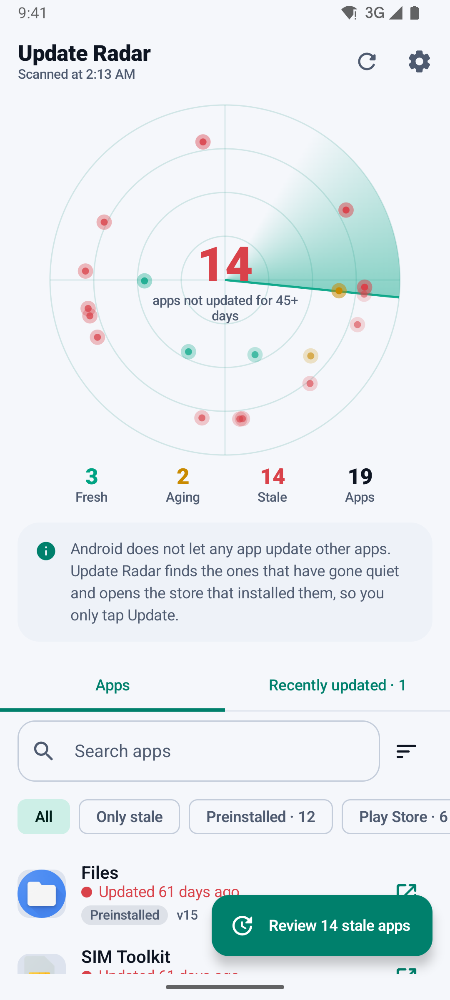
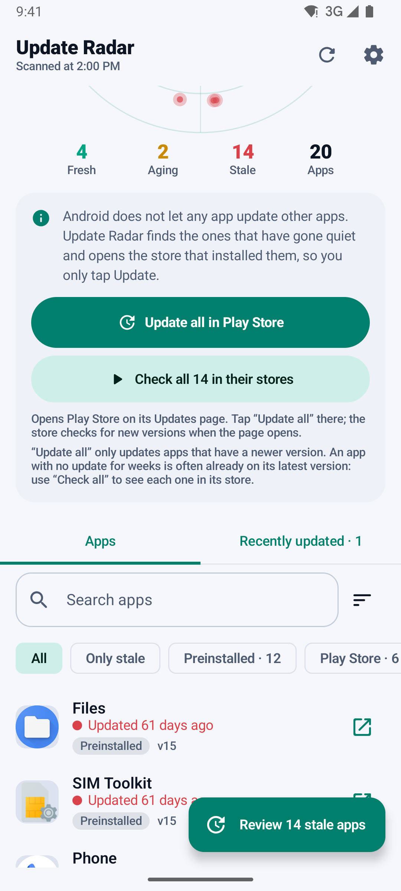
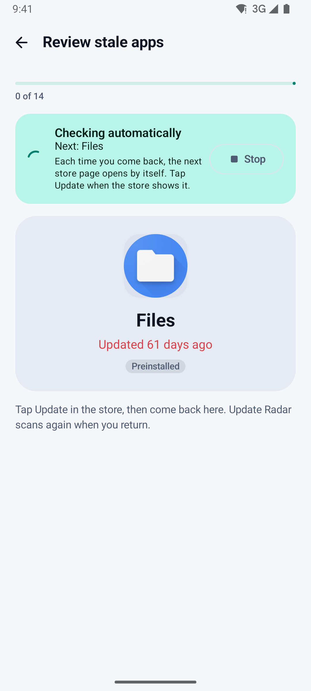
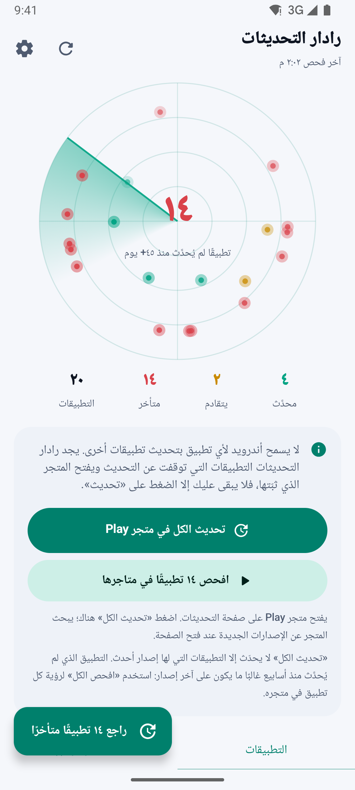
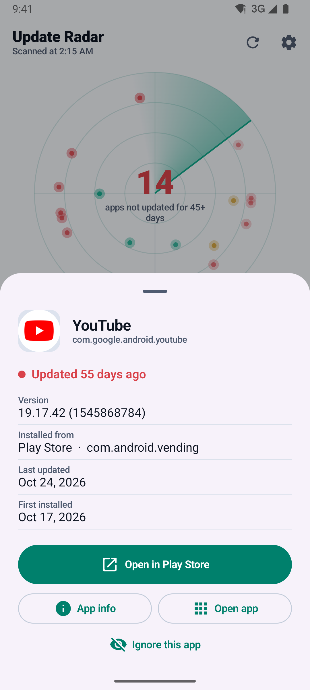
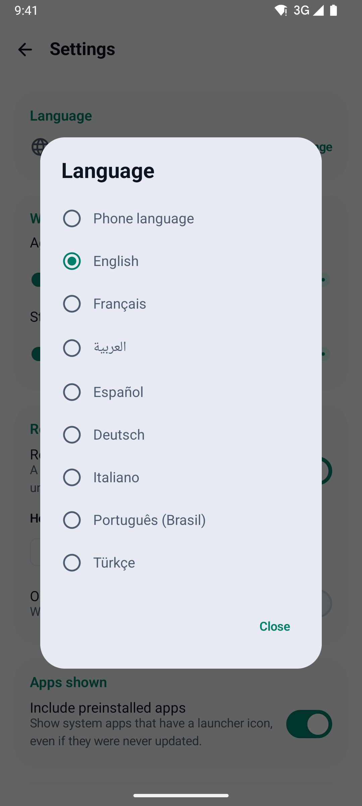
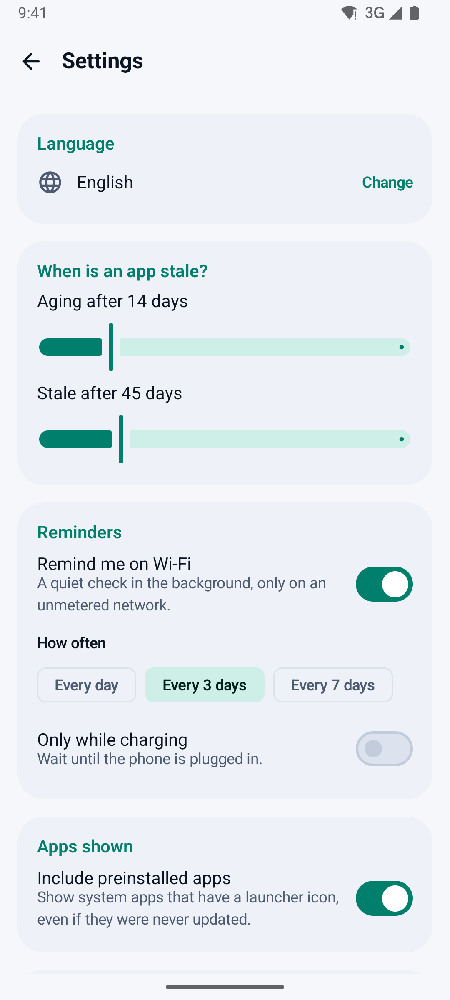
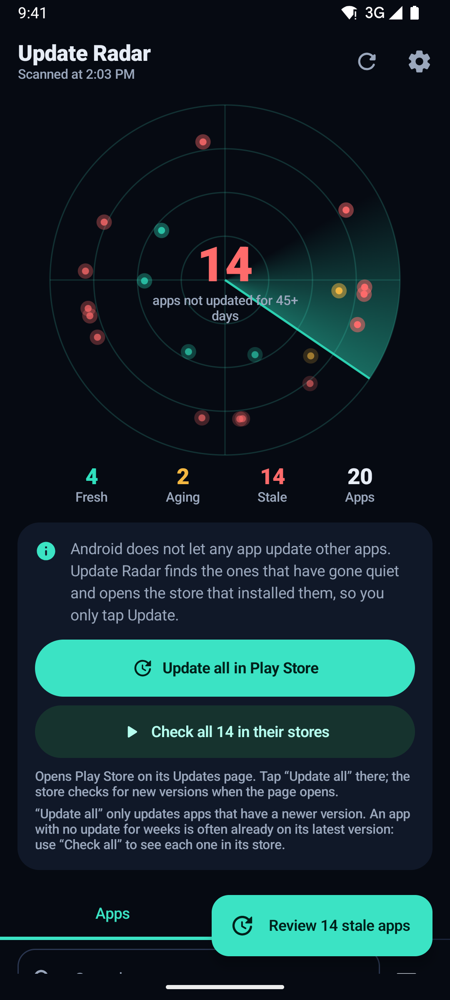

# Update Radar · رادار التحديثات

> See which Android apps have gone stale, update everything Play Store has in one tap, and walk through the rest store page by store page — Play Store and Galaxy Store. No internet permission.

[](https://github.com/Bosaj/android-update-checker/actions/workflows/ci.yml)
[](https://github.com/Bosaj/android-update-checker/actions/workflows/codeql.yml)
[](https://github.com/Bosaj/android-update-checker/releases/latest)
[](LICENSE)

**Status:** v1.2.0 · **Download:** [latest APK](https://github.com/Bosaj/android-update-checker/releases/latest) · **Android:** 8.0+ (targets Android 16, API 36) · **Idea:** #20 in the owner's ideas backlog · **Author:** Oussama EL HADJI

<p align="center">
  
  
  
  
</p>
<p align="center">
  
  
  
  
</p>

---

## The problem

On Galaxy phones some apps do not update for weeks: auto-update is off, the apps are split between Play Store and Galaxy Store, or the update notice comes late. You notice only when something breaks.

## What Update Radar does

- **Radar of your apps** — every app with a launcher icon, the store that installed it (Play Store, Galaxy Store, AppGallery, Amazon, F-Droid, other, installed by hand) and the days since its last update. Apps drift to the outer ring as they age.
- **Update all in one tap** — opens Play Store's *Manage apps & device › Updates* page, where Play's own **Update all** button updates every app that has a newer version. Opening that page also makes Play Store check for new versions.
- **One-tap updates (opt-in)** — turn on Update Radar's helper once, and **Update everything** presses Play Store's "Update all" and then every Galaxy Store app's Update button for you, with a floating progress pill and a Stop button. **Check all** walks through every stale app the same way, hands-free. Apps the store shows as current are marked **On latest version** and leave the stale list.
- **Check them all** — without the helper, the same walk with one Back press per app. The autopilot opens each stale app's own store page in turn (Play Store, or Galaxy Store for Samsung apps); every time you come back, the next page opens by itself. The store shows **Update** where a new version exists. At the end you see how many apps actually updated.
- **Fresh / aging / stale** — your own thresholds (default 14 and 45 days). Filter by store or "only stale", search, sort by stalest, newest, name or last use.
- **Last used (optional)** — with Android's Usage access, which you grant after an in-app explanation, see when you last opened each app, so you can focus on the old apps you really use. The dates stay on the phone.
- **Reminders on Wi-Fi** — a WorkManager job every 1, 3 or 7 days, only on an unmetered network (optionally only while charging).
- **Recently updated feed** — updates detected between two scans (old → new version).
- **8 languages** — English, Français, العربية (right-to-left), Español, Deutsch, Italiano, Português (Brasil), Türkçe, switchable inside the app. Light and dark themes, phones, landscape and tablets.

## What it cannot do (honestly)

Android does not let a normal app install or update another app on its own, and there is no public API that tells an app whether someone else's app has an update. Play's In-App Updates API only works for an app's own updates. So Update Radar **finds and routes**: it shows what has gone quiet and opens the store page where the Update button is. With one-tap updates on, its helper presses that button for you, the same way you would; the store does the update. Root is not used, and Samsung's "sleeping apps" setting does not stop stores from updating apps.

"Stale" means *no update for N days*, not *an update is waiting*. Many apps simply have no newer version: on a test Galaxy S23+, 80 Play-installed apps had not updated for 45 days, and Play Store had 13 updates for them. **Update all** installs those 13; **Check them all** shows each remaining app in its store so you can see for yourself.

Apps without a launcher icon are not listed: Update Radar declares a launcher `<queries>` filter instead of the sensitive `QUERY_ALL_PACKAGES` permission.

## Privacy and security

No `INTERNET` permission, no account, no ads, no analytics, no third-party SDKs that collect data. The list of your apps never leaves the phone. Read the [privacy policy](docs/PRIVACY.md) and the [security policy](SECURITY.md).

| Permission | Why |
|---|---|
| `POST_NOTIFICATIONS` | optional reminders |
| `PACKAGE_USAGE_STATS` | optional "last used" dates; special access you grant in Android settings after an in-app disclosure |
| Accessibility service (`BIND_ACCESSIBILITY_SERVICE`) | optional one-tap updates; you turn it on in Android settings after an in-app disclosure; limited to Play Store and Galaxy Store, active only during a run you start |
| `RECEIVE_BOOT_COMPLETED`, `WAKE_LOCK`, `ACCESS_NETWORK_STATE` | WorkManager runs the reminder on Wi-Fi |

The foreground-service permission WorkManager would add is removed. Release builds are minified with R8, signed with APK signature v2 and v3, and back up only settings, only to an end-to-end encrypted backup.

## Install

- **GitHub:** download `update-radar-<version>.apk` from [Releases](https://github.com/Bosaj/android-update-checker/releases) and check its SHA-256 against the `.sha256` file. Every release since 1.0.0 is signed with the same key, so updates install over the previous version.
- **Google Play:** the listing (8 languages, icon, feature graphic, screenshots) is ready in [`fastlane/metadata/android`](fastlane/metadata/android); see the wiki page *Play Store release*.

## Build

Requirements: JDK 17, Android SDK 36 (Gradle downloads it).

```bash
./gradlew testDebugUnitTest   # unit tests (staleness, filters, sorting, scan diffs, store routing, snapshot)
./gradlew lintDebug           # Android Lint, fails on errors
./gradlew assembleDebug       # app/build/outputs/apk/debug/
./gradlew assembleRelease     # signed APK, needs keystore.properties (see below)
./gradlew bundleRelease       # signed App Bundle for Google Play
```

Release signing reads `keystore.properties` (git-ignored) or the `UR_STORE_FILE`, `UR_STORE_PASSWORD`, `UR_KEY_ALIAS`, `UR_KEY_PASSWORD` environment variables:

```properties
storeFile=C:/path/to/updateradar-release.jks
storePassword=…
keyAlias=updateradar
keyPassword=…
```

## Architecture

```
data/Models.kt        Store (installer → store mapping), InstalledApp, AppChange
data/Radar.kt         pure logic: freshness, factory dates, filter/sort, summary, scan diff (unit-tested)
data/AppScanner.kt    PackageManager: launcher apps, versions, install source
data/UsageAccess.kt   optional last-used dates from UsageStatsManager
data/Snapshot.kt      previous scan + updates feed (JSON)
data/Settings.kt      DataStore preferences
work/Reminders.kt     WorkManager job on unmetered network + notification
util/StoreLinks.kt    store deep links with fallbacks, Updates pages, Samsung routing
helper/StorePage.kt   pure rules that read a store screen (exact button labels in 8 languages, Galaxy Store view ids; unit-tested)
helper/StoreHelperService.kt  opt-in accessibility helper: runs, progress pill, presses the stores' Update buttons
ui/…                  Jetpack Compose (Material 3): radar, list, detail sheet, review + autopilot, settings, onboarding
```

Kotlin 2.2, AGP 8.13, Gradle 8.14, Jetpack Compose (BOM 2025.12), AppCompat per-app languages, WorkManager 2.10, DataStore 1.1; minSdk 26, targetSdk 36. CI runs unit tests, lint, debug and release builds; CodeQL scans every push; Dependabot proposes updates weekly. More in the [wiki](https://github.com/Bosaj/android-update-checker/wiki).

## Versioning

[Semantic Versioning](https://semver.org/): `MAJOR.MINOR.PATCH`. Tags are `vX.Y.Z`, GitHub milestones and releases use the same names, and Android's `versionCode` goes up by one with every release. See the [CHANGELOG](CHANGELOG.md).

## Roadmap

- v1.0.0 — inventory, Wi-Fi reminders, store deep links, review flow, recently-updated feed ✅
- v1.0.1 — Update all in Play Store, landscape scrolling ✅
- v1.1.0 — Google Play ready (API 36), Check them all, last used, 8 languages, privacy and security hardening ✅
- v1.2.0 — one-tap updates (Update everything, hands-free Check all), "On latest version" marks ✅
- v1.3.0 — home-screen widget; optional, opt-in source checks (F-Droid index, GitHub releases) — *next*

## For LLM agents & contributors

- Be honest in the UI: the app cannot force updates; it finds and routes.
- Keep it offline: no `INTERNET` permission, so privacy is easy to prove. Any online check (v1.2) must be opt-in and documented.
- Put logic in `Radar.kt` (pure Kotlin) and test it; keep Android calls in the scanner, usage access and links.
- New user-visible text goes into all 8 `values*/strings.xml` files.

## License

[MIT](LICENSE) — © 2026 Oussama EL HADJI
