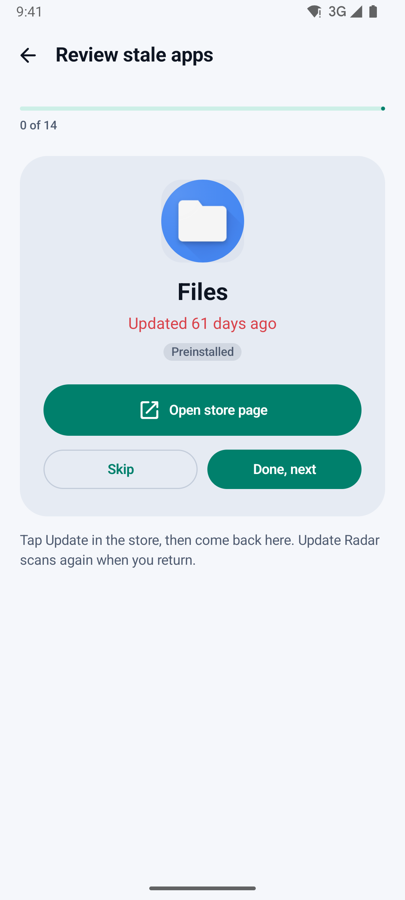

# Update Radar · رادار التحديثات

> See which Android apps have gone stale, get a reminder on Wi-Fi, and jump straight to the right store page to update — Play Store and Galaxy Store.

**Status:** v1.0.1 · **Download:** [latest APK](https://github.com/Bosaj/android-update-checker/releases/latest) · **Idea:** #20 in the owner's ideas backlog · **Author:** Oussama EL HADJI

<p align="center">
  
  
  
  
</p>

---

## The problem

On Galaxy phones some apps do not update for weeks: auto-update is off, the apps are split between Play Store and Galaxy Store, or the update notification arrives late. You notice only when something breaks.

## What Update Radar does

- **Radar of your apps** — every app with a launcher icon, the store that installed it (Play Store, Galaxy Store, AppGallery, Amazon, F-Droid, other, installed by hand) and the date of its last update. Apps drift to the outer ring of the radar as they age.
- **Fresh / aging / stale** — you choose the thresholds (default 14 and 45 days). Filter by store or "only stale", search, sort by stalest, most recent or name.
- **Reminders on Wi-Fi** — a WorkManager job every 1, 3 or 7 days, only on an unmetered network (optionally only while charging). It rescans and tells you how many apps are stale and how many updated since the last check.
- **One tap to the right store** — opens the app's page in the store that installed it (`market://details` in Play Store, `samsungapps://ProductDetail` in Galaxy Store, web fallbacks).
- **Update all in one tap** — the home screen opens Play Store's Updates page, where its own "Update all" button updates everything at once; opening it also makes Play Store check for new versions. Galaxy Store opens on its home page (Menu › Updates › Update all), because it has no public link to that page.
- **Review flow** — walk through the stale apps one by one: open the store page, tap Update there, come back, next. The radar rescans when you return.
- **Recently updated feed** — updates detected between two scans (old → new version).
- Ignore apps you never want to update, show preinstalled apps if you want them.
- **Factory versions** — many ROMs stamp never-updated system apps with a placeholder date (often 2009-01-01). Update Radar shows these as "Factory version, never updated" instead of an absurd day count, and counts them as stale.
- Arabic (RTL), French and English. Light and dark themes.

## What it cannot do (honestly)

Android does not let a normal app start an update of another app, and there is no public API that says "an update is available" for someone else's app. Play's In-App Updates API only works for an app's own updates. So Update Radar **finds and routes**: it shows what has gone quiet and opens the store page where *you* tap Update. Root is not used.

Install dates come from Android's own `lastUpdateTime`, so the radar only knows *when* an app was last updated, not whether a newer version exists.

Apps without a launcher icon are not listed: Update Radar declares a launcher `<queries>` filter instead of the sensitive `QUERY_ALL_PACKAGES` permission.

## Privacy

No `INTERNET` permission, no account, no analytics. The list of your apps never leaves the phone. Data stored: settings (DataStore), the previous scan and the updates feed (JSON in the app's private files).

## Build

Requirements: JDK 17, Android SDK 34.

```bash
./gradlew testDebugUnitTest   # unit tests (staleness, filters, scan diffs, installer mapping, snapshot)
./gradlew assembleDebug       # app/build/outputs/apk/debug/
./gradlew assembleRelease     # needs keystore.properties (see below)
```

Release signing reads `keystore.properties` (git-ignored) or the `UR_STORE_FILE`, `UR_STORE_PASSWORD`, `UR_KEY_ALIAS`, `UR_KEY_PASSWORD` environment variables:

```properties
storeFile=C:/path/to/updateradar-release.jks
storePassword=…
keyAlias=updateradar
keyPassword=…
```

## Architecture

```
data/Models.kt        Store (installer → store mapping), InstalledApp, AppChange
data/Radar.kt         pure logic: freshness, filter/sort, summary, scan diff (unit-tested)
data/AppScanner.kt    PackageManager: launcher apps, versions, install source
data/Snapshot.kt      previous scan + updates feed (JSON)
data/Settings.kt      DataStore preferences
work/Reminders.kt     WorkManager job on unmetered network + notification
util/StoreLinks.kt    store deep links with fallbacks
ui/…                  Jetpack Compose (Material 3): radar, list, detail sheet, review, settings, onboarding
```

Kotlin 2.0, Jetpack Compose (BOM 2024.10), WorkManager 2.9, DataStore 1.1, minSdk 26, targetSdk 34.

## Roadmap

- v0.1 — installed-app inventory with installer and staleness ✅
- v0.2 — Wi-Fi reminders with WorkManager ✅
- v0.3 — store deep links + review flow + recently-updated feed ✅
- v0.4 — optional source checks (F-Droid index / GitHub releases) and a home-screen widget — *next*

## For LLM agents & contributors

- Be honest in the UI: the app cannot force updates; it finds and routes.
- Keep v1 offline: no `INTERNET` permission, so privacy is easy to prove. Any online check (v0.4) must be opt-in and documented.
- Put logic in `Radar.kt` (pure Kotlin) and test it; keep Android calls in the scanner and links.

## License

[MIT](LICENSE) — © 2026 Oussama EL HADJI
