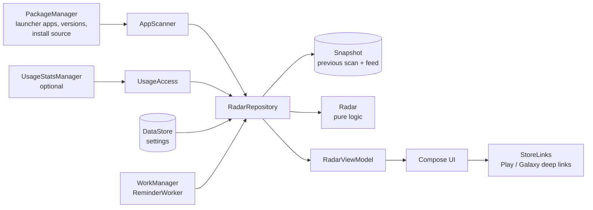

# Architecture

Update Radar is a single-module Android app (`:app`, package `ma.bosaj.updateradar`) written in Kotlin with Jetpack Compose and Material 3.

## Layers
| File | Role |
|---|---|
| `data/Models.kt` | `Store` (installer package → store), `InstalledApp`, `AppChange` |
| `data/Radar.kt` | Pure Kotlin, no Android types: freshness, factory placeholder dates, filters, sorting (stalest, recent, name, last used), summary, scan diff. Fully unit-tested. |
| `data/AppScanner.kt` | Reads launcher apps through the launcher `<queries>` filter, versions, `getInstallSourceInfo` |
| `data/UsageAccess.kt` | Optional last-used dates from `UsageStatsManager`; checks the `GET_USAGE_STATS` app-op |
| `data/Snapshot.kt` | Previous scan and the "recently updated" feed, as JSON in private files |
| `data/Settings.kt` | DataStore preferences (thresholds, reminders, ignored apps, onboarding) |
| `data/RadarRepository.kt` | One scan: apps + last-used dates, diff with the previous scan, feed |
| `work/Reminders.kt` | Periodic WorkManager job on an unmetered network, notification |
| `helper/StorePage.kt` | Pure rules that read a store screen: exact Update / "Update all" / Open / Installed labels in 8 languages, Galaxy Store's `tv_detail_install_reduce_price` view id. Unit-tested with screens captured on a Galaxy S23+. |
| `helper/StoreHelperService.kt` | Opt-in `AccessibilityService` limited to Play Store and Galaxy Store: runs a task list, opens each page, presses the button the rules point to, shows a progress pill with Stop, records apps shown as current |
| `util/StoreLinks.kt` | Store page intents with fallbacks, Play Store Updates page, Samsung routing, web links |
| `ui/RadarViewModel.kt` | UI state, review queue and the "Check them all" autopilot |
| `ui/screens/*` | Home (radar, card, list), detail sheet, review, settings, onboarding |

## Key flows
- **Scan:** on start and every time the app comes back to the foreground, so apps updated in a store leave the stale list at once.
- **Update all:** `com.google.android.finsky.VIEW_MY_DOWNLOADS` opens Play Store's *Manage apps & device* Updates page. Galaxy Store has no public link to its Updates list (its `samsungapps://` hosts are ProductDetail, SellerDetail, CategoryList, MainPage, ProductSetList and SearchResult), so it opens on its home page.
- **Check them all:** the review queue holds the stale apps, stalest first. With the autopilot on, the review screen opens the current app's store page after 1.5 s; `ON_RESUME` marks it checked and the next page opens. Apps whose `lastUpdateTime` is newer than the start of the review are counted as updated.
- **One-tap updates:** *Update everything* = Play Store's Updates page ("Update all") + every not-fresh Galaxy Store app; *Check all* = every stale app. For each task the helper opens the page, waits for the store to render, classifies it (UPDATE_ALL, UPDATE, CURRENT or LOADING), presses the button, waits 1.4 s and opens the next page; a page that never renders times out after 12 s. Apps classified CURRENT are saved with their version code and count as fresh for 30 days.
- **Store routing:** the installer's store when known; Samsung's own preinstalled apps (`com.samsung.*`, `com.sec.*`) go to Galaxy Store; everything else goes to Play Store.
- **Languages:** AppCompat per-app locales (`AppCompatDelegate.setApplicationLocales`), stored by Android 13+ and by `AppLocalesMetadataHolderService` below.

## Build
Kotlin 2.2.21, AGP 8.13.2, Gradle 8.14.6, Compose BOM 2025.12.01, minSdk 26, targetSdk/compileSdk 36. Release builds use R8 and resource shrinking and are signed with APK signature v2 + v3.
